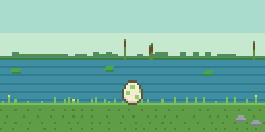
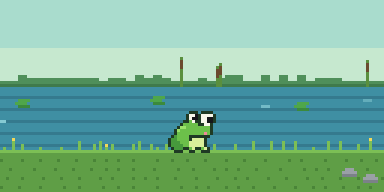
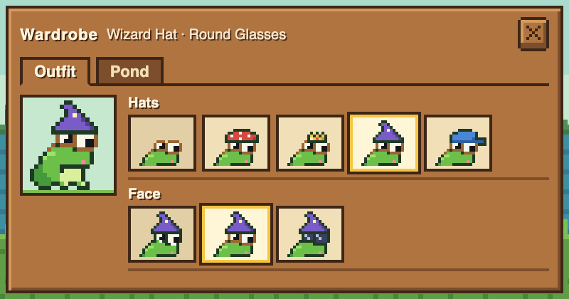
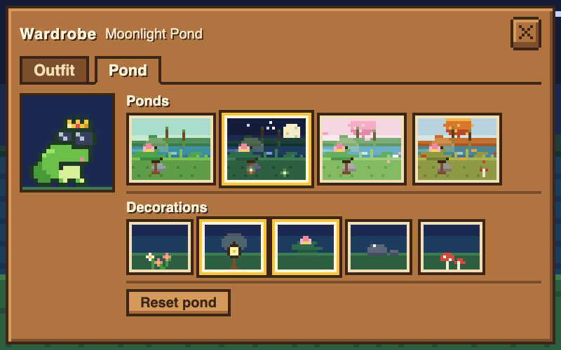
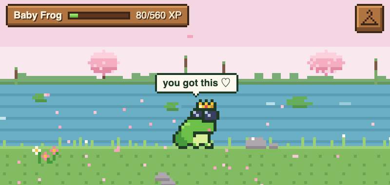

# Froggit

[](https://marketplace.visualstudio.com/items?itemName=yoonie-studio.froggit)
[](https://marketplace.visualstudio.com/items?itemName=yoonie-studio.froggit)

A cozy pixel-art frog that lives in your VS Code sidebar and **eats your bugs as you fix them**.



When your code has errors, little beetles fly into the frog's pond. Fix an error and the frog
hops over and snaps one up with its tongue. Get everything clean and it celebrates. Keep coding,
and your frog grows up, starting from an egg.

You can also dress it up, change its pond, and let it cheer you on now and then.

## How it works

| In your code | In the pond |
| --- | --- |
| An error appears | A red beetle flies in |
| A warning appears | A small yellow gnat flies in |
| You fix a problem | The frog notices, hops over and eats a bug |
| Zero errors and warnings | The frog celebrates |

The pond doesn't show one bug per problem, so 25 errors won't flood your sidebar. Up to 3 errors
show one beetle each; beyond that the swarm grows slowly to a maximum of 6 beetles and 3 gnats.

Bugs come from VS Code's own **Problems** list, so they work with any language that reports
problems: TypeScript, Python, Rust, ESLint, and so on. Note that many language tools only report
problems for files that are **open**.

## Growing up

Your frog earns XP from real coding activity:

| Activity | XP |
| --- | --- |
| Fix an error | +5 |
| Fix a warning | +2 |
| Get everything clean | +10 |
| Save a file with real changes | +1 |
| 25 minutes of active coding | +15 |

**Egg** → **Baby Frog** (40 XP) → **Developer Frog** (600 XP) → **Senior Frog** (2500 XP)

XP is designed to reward coding, not gaming the system: problems must exist for at least 15
seconds before fixing them counts, saves only count when the file actually changed (and at most
once a minute per file), and there are hourly and daily limits.

Progress is saved on your machine and follows you across all your projects. If you use
Settings Sync, it follows you to other machines too.

## Outfits, ponds and whispers

New in 0.2. Click the wooden hanger button in the top-right corner of the pond to open the
wardrobe.



### Outfits



The **Outfit** tab has four hats (mushroom hat, golden crown, wizard hat, baseball cap) and two
kinds of glasses (round glasses, sunglasses). The frog can wear one hat and one pair of glasses
at a time. The first tile on each shelf takes it off again. Each tile shows your frog wearing that
item, so you can see how it looks before you pick it.

The outfit stays on while the frog hops, eats and celebrates.

### Ponds and decorations



The **Pond** tab has four ponds: Classic, Moonlight, Sakura and Autumn. Each tile is a small
preview of that pond, and clicking one switches to it straight away.

Below them you can turn decorations on or off: a flower patch, a lantern, a lily pad flower,
shore rocks and mushrooms. Each one has its own spot, and they all sit behind the frog and the
bugs, so bugs are always easy to see. **Reset pond** goes back to the Classic pond with no
decorations.

Your outfit, pond and decorations are saved, follow you across projects, and stay as they are
when you use **Reset Progress**.

### Whispers



Every 10 minutes the frog says something encouraging in a small speech bubble, like "proud of
you!" or "don't forget water!". Only time with the pond on screen counts. The frog doesn't talk
while it's busy eating bugs, and it doesn't save up messages while you're away. You can change
how often it whispers, or turn it off, in the settings below.

## Getting started

1. Install **Froggit** from the [VS Code Marketplace](https://marketplace.visualstudio.com/items?itemName=yoonie-studio.froggit), or search for "Froggit" in the Extensions view.
2. Open the **Explorer** sidebar and expand **Frog Pond** (or run **Froggit: Show Pond**).
3. Code as usual. You can drag the pond to the bottom panel if you prefer a wider view.

## Settings

| Setting | Default | Description |
| --- | --- | --- |
| `froggit.countWarnings` | `true` | Show warnings as gnats and award XP for fixing them. Turn off if a linter reports many warnings you don't plan to fix. |
| `froggit.reducedMotion` | `false` | Calmer pond: the frog stays put unless it's eating, with no confetti, water shimmer or falling petals. Also turns on automatically when your OS "reduce motion" setting is on. |
| `froggit.whispers.enabled` | `true` | Let the frog say something encouraging now and then. |
| `froggit.whispers.interval` | `10` | Minutes between whispers: 5, 10, 15 or 30. |

## Commands

- **Froggit: Show Pond** opens the pond.
- **Froggit: Reset Progress** starts over from an egg. It asks first, and keeps your outfit and pond.

## Privacy and safety

- **Never touches your code.** The frog only reads the Problems list; it never edits files.
- **Works fully offline.** No network requests, no accounts, no telemetry.
- **The pond only sees counts.** File names, paths and code are never sent to the pond view.
- The pond runs in a locked-down webview with a strict Content Security Policy.

## Development

```bash
npm install
npm run build      # bundle extension + pond
npm run typecheck  # type-check both
npm test           # unit tests (XP rules, diagnostics diffing, bug mapping, saved looks, whispers)
npm run package    # build a .vsix
npm run demo-gif   # re-render the README GIFs from the sprites
```

Press **F5** (or **Run > Start Debugging**) in VS Code to launch a development window with the
`playground/` folder, which contains deliberate errors and warnings to test with. In development
mode there are two extra commands: **Froggit: Debug - Add 10 XP** and **Froggit: Debug - Whisper
Now**.

All art is original and drawn in code (see `src/webview/sprites/`).

## License

MIT. See the LICENSE file.
