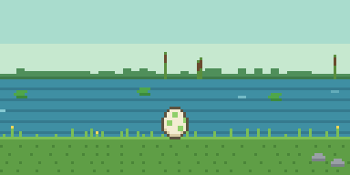
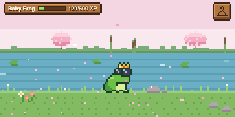
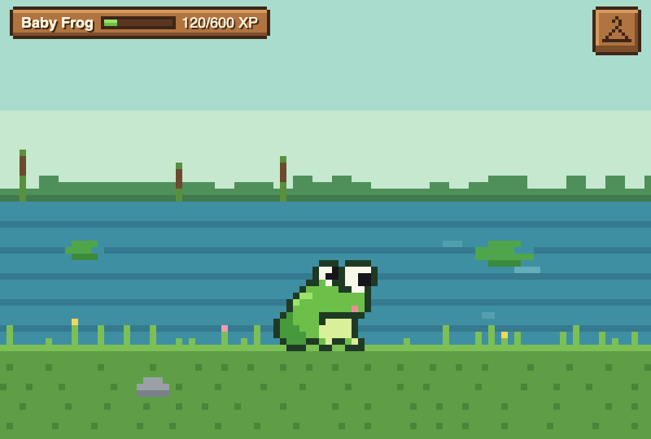
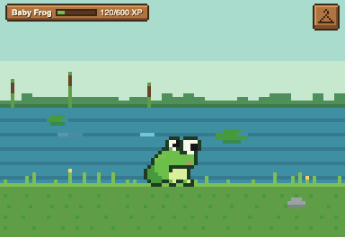
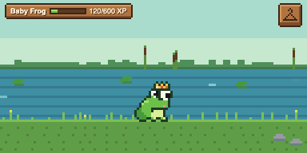

# Froggit

[](https://marketplace.visualstudio.com/items?itemName=yoonie-studio.froggit)
[](https://marketplace.visualstudio.com/items?itemName=yoonie-studio.froggit)

A cozy pixel-art frog that lives in your VS Code sidebar and **eats your bugs as you fix them**.



Froggit puts a small pond in your Explorer sidebar with a frog living in it. When your code has
errors, little beetles fly into the pond. Fix an error and the frog hops over and snaps one up
with its tongue. Get everything clean and it celebrates. The more you code, the more your frog
grows up.

It's meant to sit quietly in the corner while you work, and make fixing bugs a little more fun.

Froggit is made by one person. If it makes your day a little nicer, you can
[buy me a coffee on Ko-fi](https://ko-fi.com/yooniestudio).

## Getting started

1. Install **Froggit** from the [VS Code Marketplace](https://marketplace.visualstudio.com/items?itemName=yoonie-studio.froggit), or search for "Froggit" in the Extensions view.
2. Open the **Explorer** sidebar and expand **Frog Pond** (or run **Froggit: Show Pond** from the Command Palette).
3. Your frog hatches the first time you open the pond. Then just code as usual.

You can drag the pond into the bottom panel if you'd like a wider view.

## Your frog and its pond

When nothing is going on, the frog sits by the water, breathes, blinks, and now and then hops
somewhere else along the bank.

Bugs in the pond come from VS Code's own **Problems** list:

| In your code | In the pond |
| --- | --- |
| An error appears | A red beetle flies in |
| A warning appears | A small yellow gnat flies in |
| You fix a problem | The frog notices, hops over and eats a bug |
| Zero errors and warnings | The frog celebrates |

The pond doesn't show one bug per problem, so 25 errors won't flood your sidebar. Up to 3 errors
show one beetle each; beyond that the swarm grows slowly to a maximum of 6 beetles and 3 gnats.

This works with any language that reports problems to VS Code: TypeScript, Python, Rust, ESLint,
and so on. Many language tools only report problems for files that are **open**, so the pond
follows what's in your Problems panel.

## Say hi



Click the frog and it says something nice, like "proud of you!", "one bug at a time!" or "don't
forget water!". Each click gets a different message. It won't talk while it's busy eating a bug.

## Growing up

Your frog earns XP from real coding activity. The wooden plank in the top-left corner shows its
stage and XP. On a narrow sidebar it hides the numbers; hover over it to see them.

| Activity | XP |
| --- | --- |
| Fix an error | +5 |
| Fix a warning | +2 |
| Get everything clean | +10 |
| Save a file with real changes | +1 |
| 25 minutes of active coding | +15 |

**Baby Frog** → **Developer Frog** (600 XP) → **Senior Frog** (2500 XP)

XP rewards coding, not gaming the system: a problem has to exist for at least 15 seconds before
fixing it counts, saves only count when the file actually changed (at most once a minute per
file), and there are short-term and daily limits.

Progress is saved on your machine and follows you across all your projects. With Settings Sync
on, it follows you to other machines too.

## Wardrobe

Click the wooden hanger in the top-right corner of the pond to open the wardrobe. It has three
tabs: Outfit, Pond and Holiday.



**Outfit.** Four hats (mushroom hat, golden crown, wizard hat, baseball cap) and two pairs of
glasses (round glasses, sunglasses). The frog wears one hat and one pair of glasses at a time,
and the first tile on each shelf takes it off. Each tile shows your frog wearing that item, and
the outfit stays on while the frog hops, eats and celebrates.

**Pond.** Four ponds: Classic, Moonlight, Sakura and Autumn. Below them you can turn decorations
on or off: a flower patch, a lantern, a lily pad flower, shore rocks and mushrooms. Decorations
sit behind the frog and the bugs, so bugs are always easy to see. **Reset pond** goes back to the
Classic pond with no decorations.

Your outfit, pond and decorations are saved, follow you across projects, and stay as they are
if you reset your progress.

## Holiday



The **Holiday** tab, marked with a little star, has seasonal items.

**Free for everyone:** the **Santa hat**.

**Holiday Pack** ($0.99, one-time):

- **Snowy Pond**: snow, pine trees and a lit-up Christmas tree. Every so often "merry christmas"
  lights up the sky and your frog smiles.
- **Fireworks Pond**: a party night sky with fireworks and "happy new year".
- **Reindeer antlers**, a **party hat**, **party glasses** and a **Santa beard**.

Locked items are shown faded with a small padlock. Click one to try it on: your frog wears it in
the wardrobe's preview, so you can see how it looks before buying.

To get the pack, click **Buy** in the Holiday tab. After paying, you download a short PDF with
your license key (your receipt email links to it too). Run **Froggit: Enter License Key** from the Command
Palette and paste it in. The key is checked on your machine, with no account and no internet
needed. With Settings Sync on, the pack is unlocked on your other machines too.

## New Year party



At midnight on January 1st, by your computer's clock, night falls over whatever pond you're on.
Fireworks go off, "happy new year" lights up the sky, and a crowd of frogs shows up to celebrate
with yours for a minute. Free for everyone, no pack needed.

## Settings

| Setting | Default | Description |
| --- | --- | --- |
| `froggit.countWarnings` | `true` | Show warnings as gnats and award XP for fixing them. Turn off if a linter reports many warnings you don't plan to fix. |
| `froggit.reducedMotion` | `false` | Calmer pond: the frog stays put unless it's eating, with no confetti, water shimmer, falling petals or fireworks. Also turns on automatically when your OS "reduce motion" setting is on. |

## Commands

- **Froggit: Show Pond** opens the pond.
- **Froggit: Enter License Key** unlocks the Holiday Pack.
- **Froggit: Reset Progress** starts over with a new frog. It asks first, and keeps your outfit, pond and packs.

## Privacy and safety

- **Never touches your code.** The frog only reads the Problems list; it never edits files.
- **Works offline.** No network requests, no accounts, no telemetry. License keys are checked
  locally. The only time anything goes online is when you click Buy, which opens the store in
  your browser.
- **The pond only sees counts.** File names, paths and code are never sent to the pond view.
- The pond runs in a locked-down webview with a strict Content Security Policy.

## Development

```bash
npm install
npm run build      # bundle extension + pond
npm run typecheck  # type-check everything
npm test           # unit tests
npm run package    # build a .vsix
npm run demo-gif   # re-render the opening GIF from the sprites
```

Press **F5** (or **Run > Start Debugging**) in VS Code to launch a development window with the
`playground/` folder, which has deliberate errors and warnings to test with. Development mode adds
a few debug commands: add 10 XP, lock or unlock the Holiday Pack, and start the New Year party.

All art is original and drawn in code (see `src/webview/sprites/`).

## License

MIT. See the LICENSE file.
